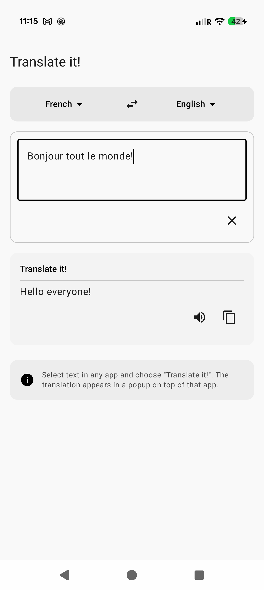
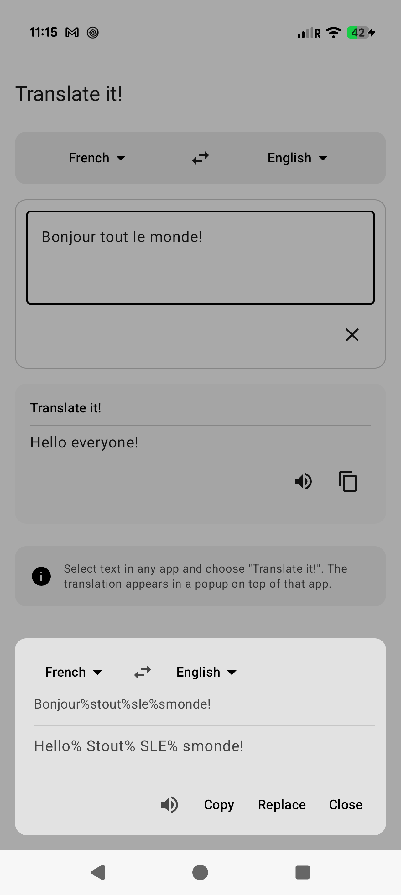
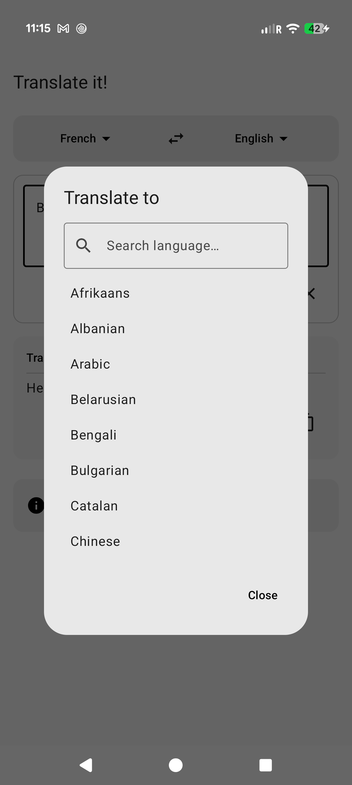

# Translate it! 🌐

[](https://developer.android.com)
[](https://kotlinlang.org)
[](https://developer.android.com/jetpack/compose)
[](https://developers.google.com/ml-kit/language/translation)
[](https://android-arsenal.com/api?level=24)

**Translate it!** is a modern, lightweight, on-device translation app for Android. It integrates seamlessly into the system text selection menu and share sheet, enabling instant translation overlays and in-place text replacement in any application without leaving your workflow.

---

## 📱 Screenshots

<p align="center">
  
  &nbsp;&nbsp;&nbsp;&nbsp;
  
  &nbsp;&nbsp;&nbsp;&nbsp;
  
</p>

<p align="center">
  <b>Main App</b> &bull; <b>Context Menu Popup Overlay</b> &bull; <b>Searchable Language Picker</b>
</p>

---

## ✨ Features

* **⚡ Instant System Integration**:
  * **Text Selection Menu (`ACTION_PROCESS_TEXT`)**: Highlight text anywhere and tap **Translate it!** to translate in a translucent popup.
  * **In-Place Text Replacement**: Replace highlighted text directly inside editable text fields with one tap.
  * **Share Sheet (`ACTION_SEND`)**: Send text from any browser or app to translate instantly.
* **🧠 100% On-Device Translation**: Powered by Google ML Kit. Works completely offline once language models are downloaded, keeping your data private.
* **🔍 Searchable Language Picker**: Quick and smooth filtering across 50+ supported languages.
* **🔄 Language Swap & Override**: Manually override auto-detection or swap source and target languages on the fly.
* **🔊 Audio Pronunciation (TTS)**: Built-in Text-to-Speech support to hear translations spoken aloud.
* **📱 Full Standalone App**: Complete interactive translation interface with clipboard paste, live translation, and copy actions.
* **🎨 Material 3 & Dynamic Theming**: Supports Material You dynamic colors, dark mode, edge-to-edge layout, and themed launcher icons.

---

## 🏗️ Architecture

The project follows modern Android architecture principles with clear separation of concerns, reactive flows, and testability:

```
app/src/main/java/com/silentpeak/mytranslator/
├── MainActivity.kt               # Main interactive application screen
├── data/
│   └── TranslationRepository.kt  # Repository interface & ML Kit implementation
├── translate/
│   ├── TranslateActivity.kt      # Lightweight translucent overlay entry point
│   ├── TranslatePopup.kt         # Translucent popup dialog composable
│   └── TranslateViewModel.kt     # ViewModel handling state, language swap, & retry
├── ui/
│   ├── LanguagePickerDialog.kt  # Searchable lazy-column language picker
│   └── theme/                    # Material 3 color schemes, typography, and theme
└── util/
    └── UiText.kt                 # Decoupled string resource localization utility
```

### Architecture Highlights

* **Repository Pattern**: [`TranslationRepository`](class://com.silentpeak.mytranslator.data.TranslationRepository) isolates ML Kit singletons and DataStore from presentation, enabling fast JVM unit testing.
* **Reactive UDF (Unidirectional Data Flow)**: UI state is exposed via `StateFlow` with lifecycle-aware subscription (`SharingStarted.WhileSubscribed(5_000)`).
* **Decoupled Localization**: `UiText` avoids coupling ViewModels to Android `Context`/`Application` references for string formatting.

---

## 🛠️ Tech Stack & Dependencies

* **Language**: Kotlin 2.2
* **UI Toolkit**: Jetpack Compose (BOM 2026.05.01) + Material 3
* **On-Device Machine Learning**:
  * `com.google.mlkit:translate:17.0.3` (Neural machine translation)
  * `com.google.mlkit:language-id:17.0.6` (Automatic language identification)
* **Storage**: Jetpack DataStore Preferences
* **Asynchronous / Concurrency**: Kotlin Coroutines & Flow
* **Build System**: Android Gradle Plugin (AGP) 9.5 with Java 17 toolchain

---

## 🚀 Getting Started

### Prerequisites

* Android Studio Ladybug / Koala or newer
* JDK 17
* Android device or emulator running Android 7.0 (API 24) or higher

### Building & Running

1. **Clone the repository**:
   ```bash
   git clone https://github.com/silentpeak/MyTranslator.git
   cd MyTranslator
   ```

2. **Build debug APK**:
   ```bash
   ./gradlew assembleDebug
   ```

3. **Run unit tests**:
   ```bash
   ./gradlew testDebugUnitTest
   ```

4. **Install onto connected device**:
   ```bash
   ./gradlew installDebug
   ```

---

## 📖 How to Use

### 1. From Any App (Context Menu)
1. Select any text in Chrome, WhatsApp, Notes, or any app.
2. In the floating text menu, select **Translate it!** (or overflow `⋮` $\rightarrow$ **Translate it!**).
3. The translation popup will appear directly on top of the active app.
4. If the text is in an editable field, tap **Replace** to replace your text with the translation.

### 2. From the Main App
1. Launch **Translate it!** from your home screen.
2. Type or tap the **Paste** button to insert text.
3. Choose or search for target and source languages.
4. Listen to pronunciation or tap **Copy** to copy the translated text.

---

## 🧪 Testing

Unit tests run on the JVM without requiring an emulator:
* [`TranslateViewModelTest`](class://com.silentpeak.mytranslator.TranslateViewModelTest): Tests state transitions (Idle, Error, Success), language swapping, retry triggers, and display name resolution using `kotlinx-coroutines-test`.

Run all tests:
```bash
./gradlew test
```

---

## 📄 License

```
Copyright 2026 Translate it! Contributors

Licensed under the Apache License, Version 2.0 (the "License");
you may not use this file except in compliance with the License.
You may obtain a copy of the License at

    http://www.apache.org/licenses/LICENSE-2.0
```
